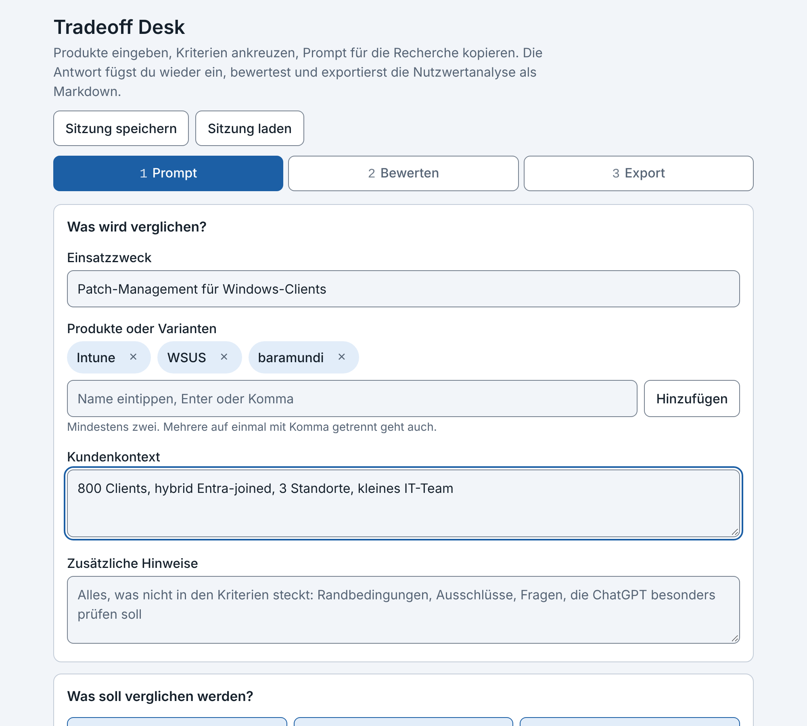
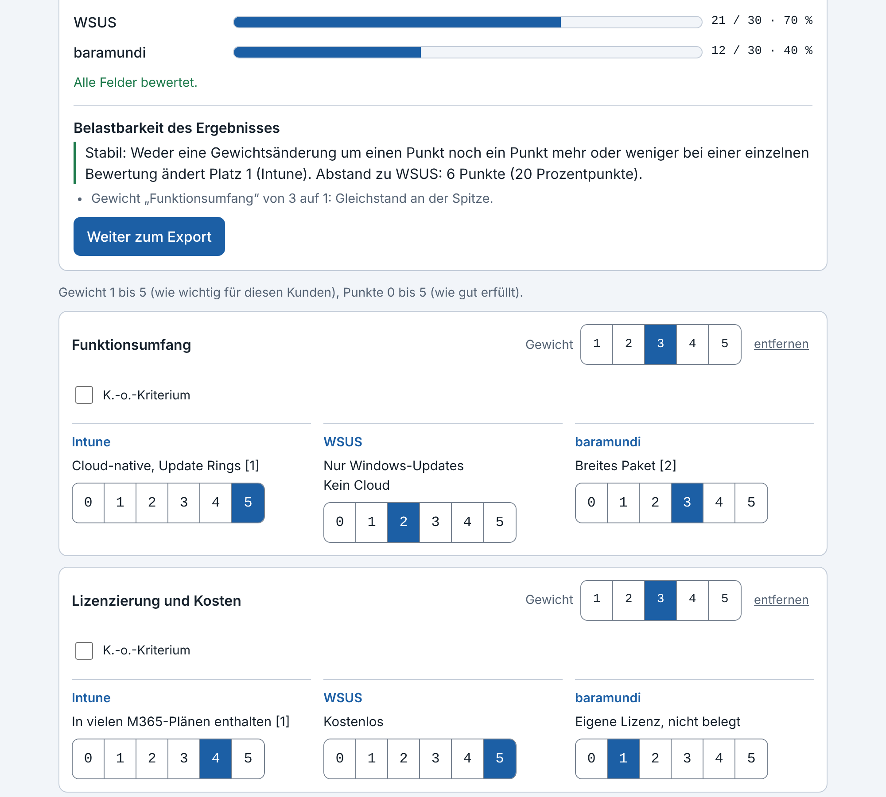

# Tradeoff Desk

Prompt-Generator und Nutzwertanalyse für Architekturentscheidungen. Recherche in ChatGPT, Gewichtung und Export als Markdown im Browser.

> **English in short:** Tradeoff Desk is a single-file, offline web app for architecture decisions. Build a research prompt for a chatbot, paste the answer back (a Markdown table), weight criteria and score options, then export a weighted decision matrix as Markdown. No server, no account, no API key, no tracking. All data stays in your browser. Download `tradeoff-desk.html` and open it. The UI is German.




## Zweck

Architekturentscheidungen scheitern selten an fehlenden Informationen, sondern an unsauberer Recherche und einer Bewertung, die hinterher keiner nachvollziehen kann. Tradeoff Desk gibt der Recherche einen festen Rahmen (Primärquellen, Quelle und Stand-Datum je Aussage, „nicht belegt“ statt raten) und macht aus der Antwort eine gewichtete, exportierbare Nutzwertanalyse. Die Bewertung machst du selbst, die App rechnet nur.

## Ablauf in drei Schritten

1. **Prompt bauen.** Einsatzzweck, Produkte oder Varianten, Kundenkontext und Hinweise eintragen, Kriterien ankreuzen (10 vorbelegt, eigene möglich). Daraus entsteht live ein Recherche-Prompt. Kopieren, in ChatGPT einfügen.
2. **Bewerten.** Die Antwort (die Markdown-Tabelle reicht) einfügen und übernehmen. Pro Kriterium Gewicht 1 bis 5, pro Produkt Punkte 0 bis 5. Das Ranking mit Nutzwert und Erfüllungsgrad aktualisiert sich live. Alternativ ohne Antwort mit den gewählten Kriterien starten. Hat der Chatbot statt der Tabelle einen Bericht geliefert, steht in Schritt 2 ein Folge-Prompt zum Umformatieren bereit. Der Parser nimmt bei mehreren Tabellen die zu den Produkten passende und stellt gedrehte Tabellen (Produkte in Zeilen) um. Tipp: normalen Chat mit Websuche verwenden, nicht den Deep-Research-Modus, der das Tabellenformat oft ignoriert. Der Prompt verlangt die Antwort in einem Markdown-Codeblock (Kopieren-Button des Chats nutzen) und optional als `.md`-Download, den „Datei laden“ in Schritt 2 einliest. Auch aus der gerenderten Ansicht kopierte, tabulatorgetrennte Tabellen werden erkannt.

**Optional: Bewertungsvorschlag des Modells.** In Schritt 1 lässt sich ein Vorschlag mit Begründung anfordern. Das Modell liefert eine zweite Tabelle (Gewicht und Punkte je Produkt, jeweils „Zahl – Begründung“). Schritt 2 zeigt sie neben den Beschreibungen, die vorgeschlagene Zahl ist markiert. In die Rechnung gehen nur deine Werte; Vorschläge übernimmst du einzeln oder gesammelt für offene Felder. Der Export kann Vorschlag, Begründung und deinen endgültigen Wert gegenüberstellen.
3. **Export.** Nutzwertanalyse als Markdown, optional mit Obsidian-Frontmatter und Beschreibungen je Kriterium. Kopieren oder als `.md` herunterladen.

Für belastbare Entscheidungen gibt es dazu:

- **K.-o.-Kriterien.** Pro Kriterium in Schritt 2 als „K.-o.-Kriterium“ markierbar, mit Mindestpunktzahl (Standard: 0 Punkte scheiden aus). Ein Produkt darunter bleibt mit seinem Nutzwert sichtbar, steht aber am Ende des Rankings, ist als ausgeschieden mit Grund markiert und kann nicht Platz 1 sein. Offene K.-o.-Felder werden gezählt und scheiden nicht aus.
- **Belastbarkeit des Ergebnisses.** Die App prüft, ob Platz 1 stabil ist: ob das führende Produkt in keinem Kriterium schlechter ist (dann hängt das Ergebnis nicht von den Gewichten ab), ob ein einzelnes Gewicht oder ein Punkt bei einer einzelnen Bewertung die Spitze ändert, und nennt Abstand und konkrete Kipp-Punkte. Gerechnet wird komplett im Browser.
- **Entscheidungsnotiz.** In Schritt 3 drei optionale Felder (Entscheidung, Annahmen, Risiken und offene Punkte), die als eigener Abschnitt im Export landen. Zusammen mit Matrix, K.-o.-Status und Belastbarkeit ergibt das eine kleine Entscheidungsvorlage.
- **Gegenprüfung durch ein zweites Modell (optional).** In Schritt 2 gibt es einen Prompt mit deiner eingelesenen Tabelle für das *andere* Modell: es prüft jede Zelle gegen Primärquellen und markiert sie mit `[OK]`, `[KORRIGIERT]`, `[VERALTET]` oder `[NICHT BELEGT]`. Fügst du die Antwort wieder ein, zeigt die App die Markierungen als Badges, korrigiert die Texte und behält deine Bewertung, Gewichte und K.-o.-Einstellungen, sofern Kriterien und Produkte gleich heißen.

Zusätzlich: **Sitzung speichern/laden** (kompletter Stand als JSON, zum Weitergeben an Kollegen) und ein **Kriterien-Editor** (Namen, Hinweise, Vorauswahl, Reihenfolge, Set als JSON speichern).

## So nutzt du es

1. [`tradeoff-desk.html` aus dem neuesten Release](../../releases/latest) herunterladen.
2. Doppelklick. Es öffnet sich im Browser, fertig. Keine Installation, kein Server, kein Konto, kein API-Key. Läuft offline in aktuellen Chrome, Edge, Firefox und Safari.

Alternativ die gehostete Version auf GitHub Pages nutzen (installierbar als PWA, funktioniert danach offline): `https://bansahome.github.io/Tradeoff-Desk/`

**Alle Daten bleiben lokal im Browser.** Es gibt keine Netzwerkanfragen, keine Schriften von Dritten, kein Tracking, keine Telemetrie. Gespeichert wird nur im `localStorage` deines Browsers (Schlüssel `tradeoff-desk-v1`). Wer den Browserspeicher leert oder ein anderes Gerät nutzt, sichert vorher über „Sitzung speichern“.

Den fertigen Prompt gibst du selbst in einen Chatbot deiner Wahl ein. Die App spricht mit keinem Dienst. Prüfe, welche Kundendaten du im Kontextfeld in einen externen Chatbot gibst.

## Entwicklung

Voraussetzung: Node.js 20 oder neuer.

```bash
npm ci              # Abhängigkeiten (nur Dev: esbuild, vitest)
npm test            # Unit- und Snapshot-Tests
npm run build       # erzeugt dist/tradeoff-desk.html und dist/pages/
npm run smoke       # Browser-Test gegen dist/ (braucht Playwright, siehe unten)
```

Der Smoke-Test prüft Prompt, Tabellenimport, Bewerten, Export, Sitzung speichern und laden, 360-px-Layout, Dunkelmodus und dass keine einzige Netzwerkanfrage nach außen geht. Playwright ist bewusst keine Abhängigkeit des Projekts: `npm i --no-save playwright` und `npx playwright install chromium`, oder eine vorhandene Installation nutzen. `SCREENSHOTS=1 npm run smoke` erneuert die Bilder in `docs/`.

Struktur, Build-Entscheidung und Anpassung ohne Eingriff in die Logik: [`docs/architektur.md`](docs/architektur.md), [`docs/anpassen.md`](docs/anpassen.md). Mitwirken: [`CONTRIBUTING.md`](CONTRIBUTING.md).

### GitHub Actions

| Workflow | Auslöser | Zweck |
|---|---|---|
| `ci.yml` | jeder Push, Pull Request | Tests und Build, Einzeldatei als Artefakt |
| `pages.yml` | Push auf `main` | Deployment der PWA-Variante nach GitHub Pages |
| `release.yml` | Tag `v*` | hängt `dist/tradeoff-desk.html` als Release-Asset an |

Release anlegen: `git tag v0.1.0 && git push origin v0.1.0`.

## Lizenz

[MIT](LICENSE)
